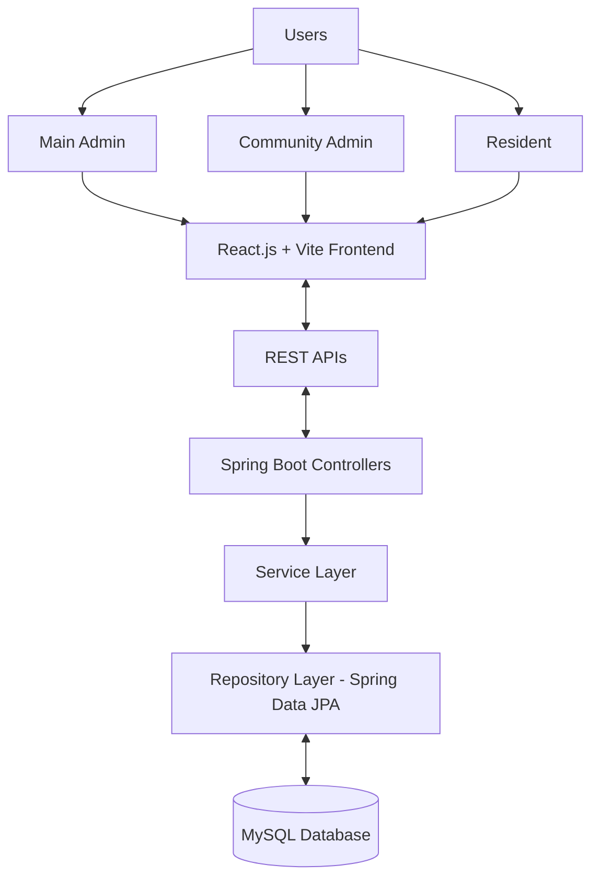

# WaterMaster – Development of a Smart Water Usage Monitoring and Automated Billing Management Platform

A full-stack web application designed to simplify water consumption monitoring, billing administration, and payment management in residential communities. The platform provides dedicated Main Admin, Community Admin, and Resident portals to improve transparency, streamline billing operations, and encourage responsible water usage.

## 📌 Project Overview

Managing water consumption and billing manually can be challenging for residential communities. Administrators need to monitor household consumption, manage water purchases, calculate bills, track payments, and resolve resident concerns. Residents need a convenient platform to view water usage, bills, payment history, and outstanding amounts.

This platform provides a centralized solution to manage water usage, automated billing, payments, and communication between administrators and residents.

## ✨ Key Features

### 1. Main Admin Portal
- Centralized platform administration.
- Management and oversight of residential communities and Community Admins.
- Document verification and administrative controls.
- Support and concerns management for handling issues raised by Community Admins and Residents.

### 2. Community Admin Portal
- Admin registration and login.
- Resident and household management.
- Water meter reading entry and consumption monitoring.
- Bulk water purchase management.
- Tariff plan configuration.
- Automated bill and invoice generation.
- Consumption-based water cost distribution.
- Invoice and payment tracking.
- Outstanding balance and overdue bill monitoring.
- Billing cycle management.
- Water usage reports and analytics.
- Water leakage reporting and management.
- Announcements, support requests, and resident concerns management.

### 3. Resident Portal
- Secure resident login.
- Personal water consumption monitoring.
- Access to generated bills and invoices.
- Current bill, payment status, and outstanding balance tracking.
- Previous billing and payment history.
- Online bill payments through Razorpay integration.
- Water leakage reporting.
- Support requests and concern submission.
- Community announcements and notifications.

### 4. Additional Features
- AI-powered chatbot using Groq API for intelligent conversational assistance.
- Multilingual support.
- In-app notifications.
- Email alerts and announcements.
- Document verification workflows.
- Community-specific data management.

## 🛠️ Technology Stack

### Frontend
- **React.js** — Builds interactive user interfaces and portal-based pages.
- **Vite** — Provides frontend development and build tooling.
- **CSS** — Handles styling and responsive layouts.

### Backend
- **Java (JDK 21)** — Core programming language.
- **Spring Boot** — Develops backend services and REST APIs.
- **Spring Web** — Handles HTTP requests and REST endpoints.
- **Spring Data JPA** — Simplifies database access and persistence.
- **Hibernate/JPA** — Maps Java objects to relational database tables.
- **Maven** — Manages backend dependencies and builds.

### Database
- **MySQL** — Stores application data, including residents, households, meter readings, billing records, invoices, and payments.
- **MySQL Workbench** — Provides a graphical interface for database management.

### Integrations
- **Razorpay** — Online bill payment integration.
- **Groq API** — Powers the AI chatbot for intelligent conversational assistance.
- **Email and Notification Services** — Support alerts and communication.


## 🏗️ System Architecture

The application follows a client-server architecture, with React.js and Vite as the frontend, Spring Boot as the backend, and MySQL as the database.




### How It Works

1. Users interact with the application through their respective portals.
2. The React frontend sends HTTP requests to the Spring Boot backend.
3. Spring Boot controllers receive requests, and service classes process business logic.
4. Repository components interact with the MySQL database through JPA/Hibernate.
5. The backend returns responses to the frontend for display.

## 🚀 Installation and Setup

### Backend — Spring Boot

Open a terminal in the backend project directory containing `pom.xml` and run:

```bash
mvn spring-boot:run
```

If the project includes Maven Wrapper on Windows, you can run:

```powershell
.\mvnw.cmd spring-boot:run
```

### Frontend — React

Open a separate terminal in the frontend directory containing `package.json` and run:

```bash
npm install
npm run dev
```

Open the local URL displayed in the terminal to access the application.

Ensure that MySQL is running and the backend database configuration is set correctly before starting the application.


## 🔮 Future Enhancements

Potential enhancements include IoT-based automatic meter readings, advanced consumption analytics, predictive water usage insights, and improved water leakage detection.

## 👩‍💻 Project Information

**Project Name:** Development of a Smart Water Usage Monitoring and Automated Billing Management Platform

**Repository:** `Water-Usage-Monitoring-and-Billing`

**Project Type:** Full-Stack Web Application

**Frontend:** React.js, Vite, CSS

**Backend:** Java, Spring Boot, Spring Data JPA

**Database:** MySQL

**Payment Integration:** Razorpay

---

This project applies full-stack development concepts to address practical challenges in residential water consumption monitoring, automated billing, payment tracking, and community administration.
